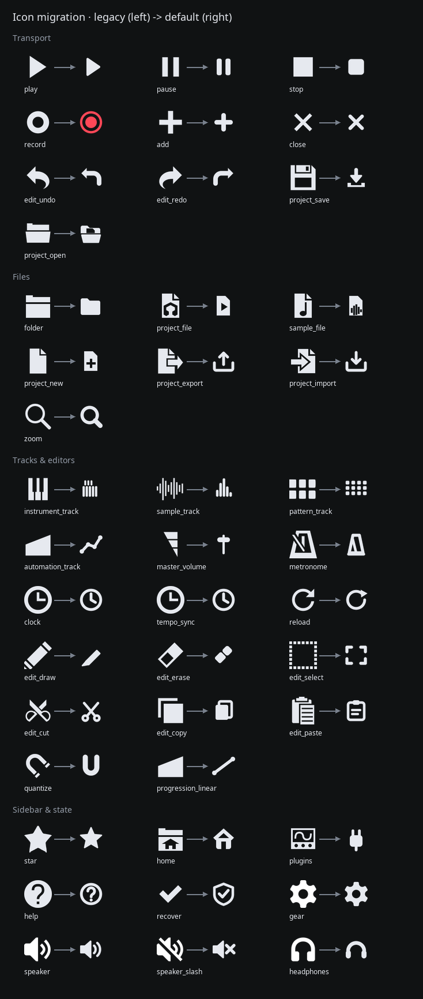

# 图标迁移对照

> 旧素材取 `data/themes/legacy/`，新素材取 `data/themes/default/`。
> 每次改动图标后，在表中追加或更新一行；只记文件名和一句备注，逐行不嵌图，统一用下面的对照图。
> 规范见 [`ui-spec.md`](ui-spec.md)。
>
> 当前覆盖：43 个图标、8 个滚动条箭头、1 个删除（`note_eight`）。最后更新：2026-11-28。
>
> 重新生成图片：`buildtools/icon-audit.py compare`（读取本文件表格）。

| 组 | 图标 | 旧 | 新 | 备注 |
| --- | --- | --- | --- | --- |
| 传输与常用 | `play` | `play.svg` | `play.svg` |  |
| 传输与常用 | `pause` | `pause.svg` | `pause.svg` |  |
| 传输与常用 | `stop` | `stop.svg` | `stop.svg` |  |
| 传输与常用 | `record` | `record.svg` | `record.svg` | 语义红 |
| 传输与常用 | `add` | `add.svg` | `add.svg` |  |
| 传输与常用 | `close` | `close.svg` | `close.svg` |  |
| 传输与常用 | `edit_undo` | `edit_undo.svg` | `edit_undo.svg` |  |
| 传输与常用 | `edit_redo` | `edit_redo.svg` | `edit_redo.svg` |  |
| 传输与常用 | `project_save` | `project_save.svg` | `project_save.svg` | U 形托盘 + 箭头 |
| 传输与常用 | `project_open` | `project_open.svg` | `project_open.svg` | 文档孔 + 前翻盖 |
| 文件与浏览 | `folder` | `folder.svg` | `folder.svg` | 单色剪影 |
| 文件与浏览 | `project_file` | `project_file.svg` | `project_file.svg` | 播放三角孔 |
| 文件与浏览 | `sample_file` | `sample_file.svg` | `sample_file.svg` | 波形孔 |
| 文件与浏览 | `project_new` | `project_new.svg` | `project_new.svg` | 加号孔 |
| 文件与浏览 | `project_export` | `project_export.svg` | `project_export.svg` | 托盘 + 向上箭头 |
| 文件与浏览 | `project_import` | `project_import.svg` | `project_import.svg` | 托盘 + 向下箭头 |
| 文件与浏览 | `zoom` | `zoom.svg` | `zoom.svg` | 搜索/缩放 |
| 轨道与编辑器 | `instrument_track` | `instrument_track.svg` | `instrument_track.svg` | 键盘 |
| 轨道与编辑器 | `sample_track` | `sample_track.svg` | `sample_track.svg` | 波形 |
| 轨道与编辑器 | `pattern_track` | `pattern_track.svg` | `pattern_track.svg` | 步进网格 |
| 轨道与编辑器 | `automation_track` | `automation_track.svg` | `automation_track.svg` | 折线 + 节点 |
| 轨道与编辑器 | `master_volume` | `master_volume.svg` | `master_volume.svg` | 推子 |
| 轨道与编辑器 | `metronome` | `metronome.svg` | `metronome.svg` | 底部中心轴，无配重 |
| 轨道与编辑器 | `clock` | `clock.svg` | `clock.svg` | 时钟 |
| 轨道与编辑器 | `tempo_sync` | `tempo_sync.svg` | `tempo_sync.svg` | 时钟 alias |
| 轨道与编辑器 | `reload` | `reload.svg` | `reload.svg` | 环形箭头 |
| 轨道与编辑器 | `edit_draw` | `edit_draw.svg` | `edit_draw.svg` | 铅笔 |
| 轨道与编辑器 | `edit_erase` | `edit_erase.svg` | `edit_erase.svg` | 橡皮 |
| 轨道与编辑器 | `edit_select` | `edit_select.svg` | `edit_select.svg` | 四角选框 |
| 轨道与编辑器 | `edit_cut` | `edit_cut.svg` | `edit_cut.svg` | 剪刀 |
| 轨道与编辑器 | `edit_copy` | `edit_copy.svg` | `edit_copy.svg` | 双页 |
| 轨道与编辑器 | `edit_paste` | `edit_paste.svg` | `edit_paste.svg` | 剪贴板 |
| 轨道与编辑器 | `quantize` | `quantize.svg` | `quantize.svg` | 磁铁 |
| 轨道与编辑器 | `progression_linear` | `progression_linear.svg` | `progression_linear.svg` | 直线 + 节点 |
| 侧栏与状态 | `star` | `star.svg` | `star.svg` | 收藏 |
| 侧栏与状态 | `home` | `home.svg` | `home.svg` | 房子 |
| 侧栏与状态 | `plugins` | `plugins.svg` | `plugins.svg` | 插头 |
| 侧栏与状态 | `help` | `help.svg` | `help.svg` | 问号 |
| 侧栏与状态 | `recover` | `recover.svg` | `recover.svg` | 盾牌 + 勾 |
| 侧栏与状态 | `gear` | `gear.svg` | `gear.svg` | 代码设置并 tint |
| 侧栏与状态 | `speaker` | `speaker.svg` | `speaker.svg` | 代码设置并 tint |
| 侧栏与状态 | `speaker_slash` | `speaker_slash.svg` | `speaker_slash.svg` | mute checked；CrossoverEQ 仍走 QSS |
| 侧栏与状态 | `headphones` | `headphones.svg` | `headphones.svg` | 代码设置并 tint |

## 已删除

| 图标 | 旧 | 新 | 备注 |
| --- | --- | --- | --- |
| `note_eight` | `note_eight.svg` | — | 未引用；与 `note_eighth` 重复 |

## 滚动条箭头

| 图标 | 旧 | 新 | 备注 |
| --- | --- | --- | --- |
| `sbarrow_up` | `sbarrow_up.svg` | `sbarrow_up.svg` | 启用 0.6 / 禁用 0.35 白；仍为静态 QSS |
| `sbarrow_down` | `sbarrow_down.svg` | `sbarrow_down.svg` | 启用 0.6 / 禁用 0.35 白；仍为静态 QSS |
| `sbarrow_left` | `sbarrow_left.svg` | `sbarrow_left.svg` | 启用 0.6 / 禁用 0.35 白；仍为静态 QSS |
| `sbarrow_right` | `sbarrow_right.svg` | `sbarrow_right.svg` | 启用 0.6 / 禁用 0.35 白；仍为静态 QSS |
| `sbarrow_up_d` | `sbarrow_up_d.svg` | `sbarrow_up_d.svg` | 启用 0.6 / 禁用 0.35 白；仍为静态 QSS |
| `sbarrow_down_d` | `sbarrow_down_d.svg` | `sbarrow_down_d.svg` | 启用 0.6 / 禁用 0.35 白；仍为静态 QSS |
| `sbarrow_left_d` | `sbarrow_left_d.svg` | `sbarrow_left_d.svg` | 启用 0.6 / 禁用 0.35 白；仍为静态 QSS |
| `sbarrow_right_d` | `sbarrow_right_d.svg` | `sbarrow_right_d.svg` | 启用 0.6 / 禁用 0.35 白；仍为静态 QSS |
